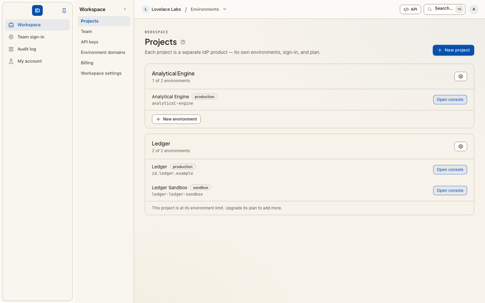

# Organizations & customers

Read this before the rest. Two things in Cbox ID are organizations, and the console keeps
them apart by where they appear:



- your **organization** is your own Cbox account: it owns projects, environments, a team
  and a bill. It is always the first crumb of the topbar;
- a **customer organization** is a team of *your* customers, inside one of your
  environments. It is a resource of that environment, listed under **Organizations**.

## The chain

```
Organization  →  Project  →  Environment  →  Customer org  →  Subject
(you, the        (one IdP      (that product's    (one of YOUR      (a person who
 Cbox account)    product)      prod/sandbox)      customers' teams)  signs in)
```

Read left to right, it is one sentence: *you* own *products*, each product has *stages*,
each stage holds *your customers' teams*, and each team has *people*.

| Layer | What it is | Who it belongs to |
|---|---|---|
| **Organization** | You. The billing customer of Cbox, and the team your colleagues join to administer your products. | Cbox ID |
| **Project** | One identity product you run. The plan and the environment allowance live here, so two products bill separately from one organization. | Your organization |
| **Environment** | A stage of that product: production, sandbox. A hard boundary with its own users, signing keys, issuer, branding and sign-in page. | Your project |
| **Customer organization** | One of your customers' companies or teams. An arbitrary-depth tree, so a group can hold companies and a company divisions. | Your environment |
| **Subject** | A person who signs in to your product. | Your environment's user pool |

## One kind of row, two places

**Your organization and a customer organization are the same kind of row.** There used to
be a separate `Account` model above the organization, with its own name, status, members
and role vocabulary: two rows for one customer, and two answers to "who may act for
them". They kept disagreeing, so that row was removed rather than reconciled. Your
organization lives in the platform-root environment, and its team are ordinary
subjects holding a membership of it.

That is why one sign-in reaches everything you administer. Both are an `organizations`
row; where the row lives says which one it is:

- In the **platform root**, the row is **an organization**: a customer of Cbox. Before
  v3 the console called it a *workspace*.
- In **your own environment**, the row is **a customer organization**: one of your
  customers' teams. On your environment's own host there is only this kind, so its pages
  just say *organization*.

**The tell: your organization owns projects. A customer organization does not.** If the
thing in front of you has projects, environments and a bill, it is your organization. If
it has members, roles and SSO connections and lives inside one environment, it is one of
your customers.

## Which console you are in

You administer the two through two consoles.

### The organization console

On the platform root host of a hosted deployment (`cboxid.com`), signed in as yourself.
Its rail holds your organization and nothing else:

| Area | Pages |
|---|---|
| **Organization** | Projects, Team, API keys, Environment domains, Billing, Organization settings |
| **Team sign-in** | Enterprise SSO, Authentication policy: how your own team signs in to Cbox |
| **Audit log** | Audit log |
| **Account** | Security, Sessions & activity |

The pages that administer end users (roles, permissions, applications, webhooks, hooks,
token vault, connectors, access reviews and the rest) are not on this rail. At the
platform root they would administer your organization's own record in Cbox's environment,
which nobody signs in to except your team. Your product's users, apps and roles live in
an environment console.

Those pages are **hidden from the rail, not redirected.** Three reasons:

- **Nothing is stranded.** If you registered an app or a webhook there before this
  change, you can still open it by URL and delete it. A redirect would have made it
  unreachable without making it go away.
- **One gate decides access.** The pages stay authorized by the same check as every other
  console page. A redirect would be a second gate that has to agree with the first on
  every route, forever; a filter on what the rail shows cannot lock anybody out.
- **The page says what it is.** Reached by URL, it shows a notice above the content: the
  page manages your organization's own record in Cbox, not your product, with a link to
  Projects.

The organization console also has no Overview page (`/dashboard`) and no setup guide
(`/get-started`). Both described your organization's own record, not your product.

An operator and a single-tenant install (where the root environment *is* the product)
keep every page there. Your customers get the narrower console below.

### Your customer's organization console

On your environment's own host, signed in as one of your customers' administrators: a
person who signs in to your product and administers their company's organization in it.
This console is an admin portal for their IT department, exactly Members, Enterprise
SSO, Domains, Directory Sync, Roles and the Audit log, plus their own pages:

| Area | Pages |
|---|---|
| **Overview** | Overview (their organization's numbers and recent activity), Approvals (requests to act as them) |
| **Members & roles** | Members, Roles |
| **Sign-in** | Enterprise SSO, Domains, Directory Sync |
| **Audit log** | Audit log, and App audit logs when the organization's plan includes them |
| **Account** | Security, Sessions & activity, My API keys (when one of your apps offers them), Trusted devices (when the devices module is on) |

Everything else is your product's administration and lives in the environment console:
applications and APIs, webhooks, hooks, the token vault, access reviews, role conflicts,
outbound provisioning, log streams, social login, authentication policy, appearance and branding,
usage, settings, permissions, member API keys, the setup guide and the module pages
(sign-in activity, compliance, connectors, trusted-device inventory, risk events).
Permissions are what your apps enforce, so writing new ones is yours; your customer still
builds roles out of the permissions that exist, on the Roles page.

Those pages are **not there** on this console, not just hidden from the rail: their URLs
answer 404, writes included. Unlike your organization console there is nothing to strand, since
the same records stay reachable from your environment console at `/admin`. One list decides
both the rail and the 404, so the two cannot disagree
([`CustomerConsole`](https://github.com/cboxdk/cbox-id/blob/main/app/Platform/Console/CustomerConsole.php)).

Your customers' organization console and the environment console used to be required to offer the
same capabilities, with a doctor check that failed if they did not. That rule is gone:
the consoles differ on purpose now.

### An environment console

At `/admin` on that environment's own host, reached from **Projects** with **Open
console**, or from the environment switcher in any console's topbar. Its rail is about
your product, in the words other identity platforms use for the same things. Nothing on
it is about your Cbox organization, and everything your customers' own console leaves out is
here.

| Area | Pages |
|---|---|
| **Home** | Overview, Get started |
| **Users & orgs** | Users, Organizations (your customer organizations) |
| **Authentication** | Sign-in methods, Authentication policy, Social login, Enterprise SSO, Domains, Directory Sync, Radar, Trusted devices (devices module) |
| **Authorization** | Roles, Permissions, Fine-grained authorization, Access reviews, Role conflicts |
| **Developers** | Applications, APIs, API keys, Webhooks, Hooks, Feature flags, Pipes |
| **Connectors** | Catalog, Connections (connectors module) |
| **AI agents** | Agents, Approvals, Connect |
| **Branding** | Branding (the sign-in theme, logo and favicon; with the white-label module, the name, sender and palette) |
| **Monitoring** | Audit log, Log streams, Usage, Sign-in activity, Audit trail, Exports & retention, Risk events (each from its module) |
| **Advanced** | Admins & support, Token vault, Outbound provisioning, SAML apps, Legacy login |
| **Settings** | Settings |

**Authentication** holds every way people come *in*; the outbound directions (SAML apps
that trust this environment, provisioning out to other systems) are under **Advanced**
with the rest of what is set up once and rarely revisited. **Authorization** sits right
beside it: what people may do once they are in. The URLs did not change when pages were
renamed or re-filed, so bookmarks and links keep working. [Finding your
way](../getting-started/finding-your-way.md) walks the common tasks click by click.

## Moving between them

Every console has the same topbar: where you are on the left, search and your account on
the right.

```
Acme ▾  /  Checkout ▾  /  Production ▾ [PRODUCTION]  /  All organizations ▾
```

- **Organization ▾** lists the organizations you belong to. On the organization console
  choosing one switches to it; on an environment console it opens the organization
  console, where your session is. An organization that owns no projects shows its name
  here with nothing after it.
- **Project ▾** lists your organization's projects. Choosing one opens the environment there
  that matches the one you are in: production for production.
- **Environment ▾** lists the environments of this project you may administer, each with
  its type. Choosing one opens the **same page** there: Users in sandbox becomes Users in
  production. A page about one record (a user, an app) opens that list instead, and a
  page the other environment does not have opens its Overview.
- On the organization console no environment is current, so the second crumb is
  **Environments ▾**: every environment you may open, grouped by project.
- **All organizations ▾**, on an environment console only, filters every page to one of
  your customer organizations. It is a search, because an environment can hold thousands.

Only what you may open is listed. A Viewer sees no environments, and a member limited to
some environments sees those. Another organization's projects appear only once you
switch to it. Each menu gets a search box once it holds more than eight entries.

Switching environment goes through the same signed handoff as **Open console**; the page
to land on travels with it, and the environment refuses any target that is not one of its
own console pages.

**The account menu** is the avatar top right: **Organization settings** (if you may
change them), **Account**, **Switch account**, **Platform admin** (operators only),
**Theme** and **Sign out**. On an environment console the account links open on the root
host, because your own sign-in belongs to Cbox ID, not to the environment.

**The rail shows its labels by default.** The pin at the top of the rail collapses it to
icons; the choice is remembered in this browser.

### Platform admin

Whoever runs the install reaches the platform pages (organizations, environments, the
customer organization tree, operators, usage, queues) as the **Platform** area of the platform
environment's console, `/admin` on the root host — the same console, rail and
⌘K as the platform environment's own settings. From the organization console, **Platform
admin** in the account menu goes there. The line above every Platform page says
**Platform admin: The whole deployment**, in the warning colours, because a click there
acts on every organization on the install. Re-pointing the platform pages at another
environment is done on **Platform › Environments**. On a single-tenant install the same
pages are a **Platform** area of the console's rail.

## Where you land after signing in

A member of an organization lands on **Projects**, which lists every environment with **Open
console** beside it. Signing in at `cboxid.com` never opens an environment's console by
itself.

The one exception is a sign-in that started at an environment's console. If you open
`acme.cboxid.com/admin/users` signed out, you sign in at `cboxid.com` and land back on
that page. This only works within 15 minutes of being sent to sign in, and only in the
browser that was sent.

## Signing out

**Sign out** signs you out of the context you are in, everywhere that context reached.

- **Your Cbox ID sign-in** (the organization console, Account, the platform console, and
  every environment console you opened from them): signing out of any of them signs you
  out of all of them, for every account the browser holds, in every tab. You land on
  **You're signed out**, and every console asks you to sign in again.
- **A tenant's own users** on the tenant's host (its sign-in page, its Account page, its apps'
  sign-out): signing out there ends only their session. It never closes the environment
  console on the same host, and closing the console never signs them out.

Sign-ins on your other devices stay signed in. To end those as well, use **Sign out other
sessions** in Account.

## Related

- [Unified identity](unified-identity.md): the design record for why the separate
  account row was removed rather than kept alongside.
- [Keys](../guides/keys.md): the keys each console issues.
- [Integrate your app](../getting-started/integrate-your-app.md): registering an app
  inside an environment.
